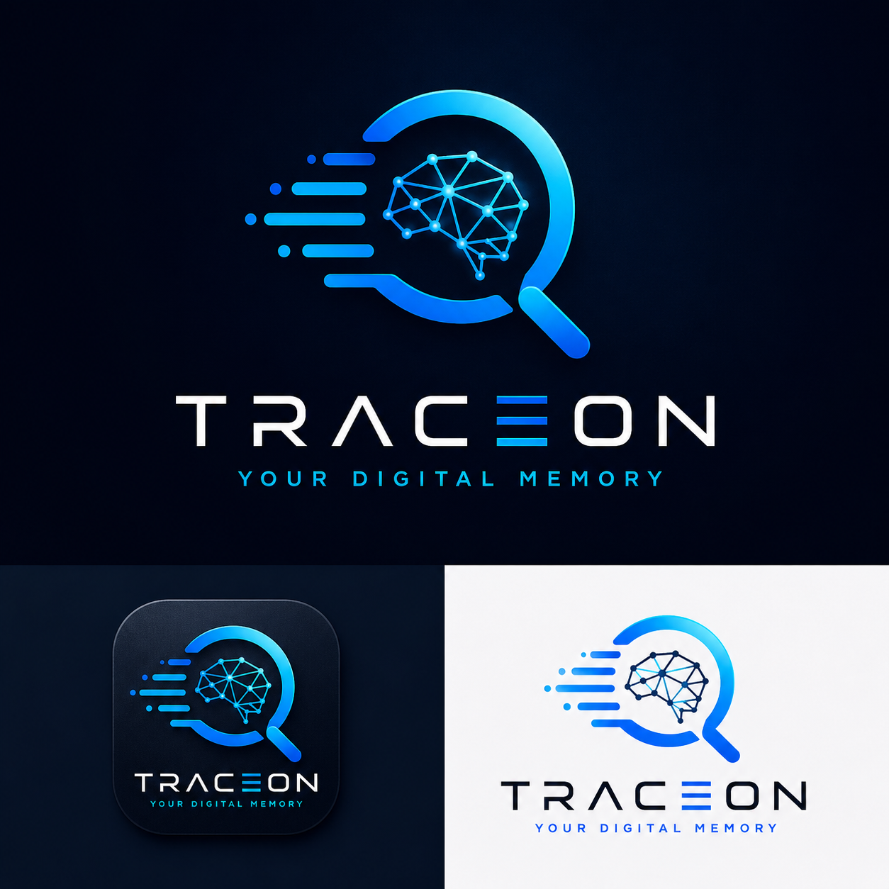

# TRACEON - Your Digital Memory

A native Android app (Kotlin, Jetpack Compose, Room) that turns the things you watch, read, search and save into one
searchable, local-first **knowledge graph**. The "map" is a graph of platforms -> content types -> topics -> items, not a geographic map.



## Read this first: verification status

This source tree was written in an environment with **no Android SDK, no Gradle and no network**. So:

| Item | Status |
|---|---|
| Kotlin / Compose / Room sources, Gradle config, manifest | Written. **Not compiled yet.** Expect to fix a few compile errors on first build. |
| Unit tests (18 classes, 78 test methods, JVM) and instrumented tests (4 classes, 19 methods) | Written. **Not run yet.** Expected values were derived by hand / scripted, not by execution. |
| Static checks that were run | Brace/paren balance on every file; every `com.traceon` import resolves to a declaration; package matches directory; all 104 Room `@Query` bind parameters match their function parameters. |
| Debug / release APK | **Not built here.** `android.yml` builds and uploads the debug APK; `release.yml` publishes to GitHub Releases ([docs/RELEASE.md](docs/RELEASE.md)). Both workflows are YAML-validated only, never run. |
| Any integration on a real device or emulator | **Not tested.** Nothing below should be read as "works" until the test jobs pass on your side. |

Build: [docs/BUILD.md](docs/BUILD.md). Releases: [docs/RELEASE.md](docs/RELEASE.md). Bug audit: [docs/AUDIT.md](docs/AUDIT.md). Honest platform limits: [docs/LIMITATIONS.md](docs/LIMITATIONS.md). Data handling: [docs/PRIVACY.md](docs/PRIVACY.md).

## What it does

* **Content Map** - interactive graph (pan, zoom, expand/collapse, multi-select, node search, filters by platform / type / category / creator / date, relationship highlighting, paged clusters, export to JSON/PNG, user-created links). Only opened branches are materialised; a topic shows 12 items per page.
* **Home** dashboard, **Activity** timeline (Today / Yesterday / 7 / 30 / 90 days / custom range; edit, delete, notes, tags, open original), **Analytics** (overview, platforms, Topic Explorer, Browser Intelligence), **Search** (instant local search, suggestions, recents, saved searches, filters, sorting), **Content detail**, **Smart Discovery** (offline, rule-based, answers cite stored records), **Import Center**, **Settings**, **Permissions**, **Backup & Restore**, **TRACEON browser**.
* Every statistic is an aggregate over real database rows. Unmeasurable durations are `n/a`, never `0`.

## How data gets in (and what each method can and cannot do)

| Method | Does | Does not |
|---|---|---|
| App usage (UsageStatsManager) | Foreground start/end of apps **you opt in per app**; off by default; needs Usage access granted in system settings | Say which video, reel or page was open. App-level only. |
| Share target ("Save to TRACEON") | Saves a link/text after you confirm it | Fetch titles over the network. The title is only what the sender shared. |
| Browser history import | Google Takeout Chrome `BrowserHistory.json`, a JSON list of `{url,title,time}`, or CSV with url + time columns | Read other browsers' private history directly. |
| Google activity import | Takeout "My Activity" / YouTube JSON: Watched, Searched for, Visited (ad impressions ignored) | Anything not in the export. |
| Manual entry | Typed items; asks before merging similar titles | - |
| TRACEON browser | Records pages and searches opened inside it, with foreground time on page; Private mode records nothing | Observe any other browser. |
| Accessibility service | **Not implemented in this version** (see limitations) | - |

Every record stores its collection method and a data status (observed / imported / manual / inferred / metadata unavailable / demo sample). Re-importing a file never double-counts (unique indices on events).

## Classification and discovery

Offline keyword/domain scoring over the metadata that is actually present (title, description, tags, authorised text, domain). With too little evidence an item stays **Unclassified** with confidence 0; a bare URL is never "understood". You can correct any category (kept across re-classification) and create custom categories and tags. Similar content, same creator, numbered learning sequences and cross-platform matches become graph relations. No cloud AI exists in this build, so nothing leaves the device.

## Architecture

Single Gradle module, package-by-layer, Clean Architecture + MVVM + repositories, Koin for DI.

```
com.traceon
  core/common      URL canonicalisation, platform + search-engine detection, normaliser, time/text utils
  core/graph       graph model, builder (expansion + paging), radial layout, export
  core/ui          theme, components, charts (hand-drawn Compose, no chart dependency)
  domain/          models, repository interfaces, classifier, similarity, discovery parser/engine
  data/local       Room: 18 entities, 1 view, 5 DAOs, converters, migrations, search builder
  data/repository  implementations (single write path with dedupe -> classify -> relate)
  data/imports     CSV / Takeout parsers          data/backup  JSON backup, AES-GCM, CSV export
  feature/*        dashboard, contentmap, activity, analytics, search, contentdetails, discovery,
                   importcenter (+ share, manual, demo), settings (+ permissions), backup, browser, tracking
  di/ navigation/  Koin module, NavHost + bottom bar
```

Database: `ContentEntity` (unique `dedupKey`), `ActivitySessionEntity`, `BrowserActivityEntity`, `SearchActivityEntity`, `ContentRelationEntity`, taxonomy (`Category`, `Topic`, `Creator`, `Tag` + cross refs), `ApplicationEntity`, `PlatformEntity`, `ImportJobEntity`, `TrackingSourceEntity`, `PermissionStatusEntity`, `UserPreferenceEntity`, `SearchHistoryEntity`, and the `activity_events` view that unifies all events for timeline, charts and date questions. Foreign keys with cascades, indices, transactions around every write, schema export, explicit migration policy (no destructive fallback).

Identity order for duplicates: platform content id -> canonical URL (tracking params, `www`, fragment, trailing slash removed) -> platform + type + exact normalised title. Manual entries without a URL never merge automatically.

## Phases

| Phase | Scope | In this tree |
|---|---|---|
| 1 | Setup, navigation, design system, database | yes |
| 2 | Manual entry, Share, library | yes |
| 3 | Browser + Google activity import | yes |
| 4 | App usage tracking + permission system | yes (UsageStats; no accessibility) |
| 5 | Classification and topics | yes |
| 6 | Interactive knowledge graph | yes |
| 7 | Dashboard, analytics, timeline, search | yes |
| 8 | Smart discovery | yes (offline, rule-based) |
| 9 | Security, export, backup/restore | yes (optional AES-256-GCM) |
| 10 | Tests, optimisation, APKs | tests written; APKs via CI |

"In this tree" means the code exists, not that it has been compiled or verified.
